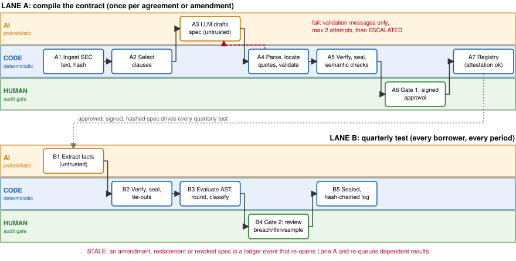

# Auditable Covenant Compliance: compile the contract once, compute it deterministically every quarter

**Domain:** commercial-loan financial-covenant monitoring. **Jurisdiction:** US credit agreements (NY law), using public EDGAR Exhibit 10 filings and 10-Q/10-K financials. For another jurisdiction the definitions and amendment conventions change; the architecture does not. **All cost figures below are my estimates, not sourced data, and every example is synthetic.**

**What surprised me.** The ratio math is trivial (net debt / EBITDA). The risk is the *definition*: "Consolidated EBITDA" differs per agreement, add-backs are capped, cash netting is capped, thresholds step down, and amendments silently redefine terms. A template fails because every agreement is bespoke, and one LLM call that returns the ratio cannot be audited.

## 1. Problem statement

| | |
|---|---|
| **Who** | Covenant-monitoring analysts in credit administration at a mid-market lender; the credit officer who signs findings. |
| **Task** | Each quarter, per borrower: find the financial covenants in a 100-300 page agreement, apply all amendments, extract inputs from the financials and compliance certificate, recompute ratios under the contract's own definitions, flag breaches and thin headroom. |
| **Frequency** | Quarterly (some monthly). About 400 borrowers gives about 1,600 tests a year. Certificates are due about 45 days after quarter end, so about 60% of tests land in one 3-week window. |
| **Cost today** | About 4.5 h per test, about 7,200 h a year, roughly 4 FTE, about $650K a year at $90/h loaded. The larger cost is a breach found late (lost early-intervention leverage) or a false pass. |
| **Out of scope** | Waiver and reservation-of-rights decisions, legal notices, pricing and rating, non-financial covenants, equity-cure modelling (flagged only), pro-forma acquisition adjustments, any real client data. The system gives decision support, not legal advice. |

## 2. Solution design

**Core idea.** The LLM compiles each agreement version once into a typed, human-approved `CovenantSpec`. A deterministic engine then executes that spec every quarter. The LLM never touches a number that enters a ratio without a verified source span. **Why AI at all:** definitions are bespoke natural language with cross-references ("as amended by Amendment No. 2"); that is the one step regex and templates cannot do.

| # | State | Actor | What happens / exit guard |
|---|---|---|---|
| A1 | INGESTED | Code | Immutable store, SHA-256, per-page canonical text with offsets (OCR flagged with confidence). |
| A2 | LOCATED | AI + code | Hybrid retrieval finds covenant section, definitions, amendments; a deterministic cross-reference resolver loops until no capitalised term is undefined. |
| A3 | EXTRACTED | **AI** | Extractor emits a `CovenantSpec` draft; each definition, threshold and constant carries a verbatim quote with page and offsets. |
| A4 | GROUNDED | Code | `verify_span` (quote must equal page text at offsets), schema, no unsourced literals, no cycles, no threshold gaps. Fail: error fed back, max 2 retries, then ESCALATED. |
| A5 | SPEC_REVIEW | **Human, gate 1** | Side-by-side PDF highlights and a plain-English rendering of the formula **generated from the AST by code, not the LLM**. Edits stored as a diff. Credit officer signs; second signer above an exposure limit. |
| A6 | ACTIVE | Code | Spec frozen and hashed. Any change is a new version. |
| B1-2 | FACTS_EXTRACTED | **AI** | Maps statement lines to the spec's declared inputs, with source table cell. It sees only the input list, never thresholds or prior results, so it cannot "aim" for a pass. |
| B3 | FACTS_CHECKED | Code | Span check, scale and sign normalisation, tie-outs (debt components sum to total, balance identity, period match), prior-quarter restatement check. |
| B4-5 | COMPUTED, CLASSIFIED | Code | `Decimal` evaluation of the AST with a trace per node; contract rounding applied; `classify()` returns PASS, PASS_THIN_HEADROOM, BREACH or INDETERMINATE. A missing or unverified input is INDETERMINATE, never PASS. |
| B6 | REVIEW_GATE | **Human, gate 2** | Routed to a human: every BREACH or INDETERMINATE, thin headroom, any failed tie-out, first test after a spec change, plus a random 10% sample of clean passes to measure the silent error rate. Analyst confirms, overrides with written rationale, or rejects facts. |
| B7-8 | SEALED, STALE | Code | Result, spec hash, fact ids and engine version appended to a hash-chained log. An amendment, restatement or revoked spec marks dependent results stale and re-queues them. |

**Knowledge management.** Contract meaning lives in the approved, versioned `CovenantSpec` (code, not weights). Evidence lives in the hashed document store. Bank policy (thin-headroom %, sampling rate) lives in config. The LLM holds no knowledge the system depends on. **When knowledge becomes invalid:** (1) a new amendment or side letter creates a new spec version and supersedes the old; (2) a borrower restatement flags every result that used the old facts; (3) a revoked spec flags every dependent result `stale`; (4) stale results are re-run and a human sees any change in status. Nothing is silently edited.

**Audit lineage.** Every output walks back: `status -> ratio -> TraceStep -> fact_id -> SourceSpan(doc_sha256, page, char_start:char_end, quote) -> clause text`, and via `spec_hash` to the approving human. An auditor can re-run the sealed inputs through the pinned `engine_version` and get the same result.

## 3. Pydantic models (full code: `covenant_audit/models.py`, 15 tests passing)

| Model | Role and enforced invariants |
|---|---|
| `SourceSpan` | `doc_sha256`, `page`, `char_start/end`, verbatim `quote`, optional `table_cell`; OCR spans must carry a confidence. `verify_span()` raises if the quote is not at the offsets, and only then sets `verified`. |
| `Expr` (AST) | `Lit, Input, TermRef, Sum, Diff, Mul, Div, MinOf, MaxOf`. The LLM writes data, never code: no `eval`, no generated Python. Non-structural literals (e.g. the 25% cap) must cite a clause. |
| `CovenantSpec` | Numerator, denominator, comparison, defined terms, inputs, threshold schedule, rounding rule. Rejects undeclared inputs, unresolved or cyclic terms, unsourced literals, schedule gaps. Cannot be VERIFIED with unverified spans or APPROVED without a human. Frozen, `content_hash()`. |
| `FinancialFact` | `Decimal` value in whole units, currency, printed scale, period, source cell, tie-out checks; `verified` only if span and all tie-outs pass. |
| `CovenantTestResult` | Raw and tested ratio, threshold, headroom, status, trace, review, `stale`, `prev_hash`. A validator rejects any status that contradicts the arithmetic, and requires review for BREACH/INDETERMINATE. |
| `ReviewDecision` | Non-confirm decisions need a written rationale; `override_value` required iff overridden. |

Money and ratios are `Decimal`, never `float`. `classify()` is the only place status is decided.

## 4. Vulnerability and risk analysis

**Weakest link: a wrong but well-grounded spec at gate 1.** Grounding proves a quote *exists*; it does not prove the model *read it correctly* (e.g. it cites the pre-amendment cap, or reads "25% of EBITDA" as 25% of post-add-back EBITDA). Every deterministic check passes, and a tired reviewer approves a plausible spec (automation bias). Because the spec drives every quarterly test for years, one error repeats silently. Mitigations: (a) **back-test**: the spec must reproduce the ratios in the borrower's last 2-4 historical compliance certificates, which act as an independent oracle; a gap above rounding tolerance blocks approval; (b) two independent extractions (different model or prompt) diffed field by field; (c) the AST-generated plain-English rendering so the reviewer sees what the *engine* will compute, not what the LLM says it will; (d) the 10% clean-pass sample.

| Input condition | Failure mode | Design response |
|---|---|---|
| **Noisy** | Scanned PDF, OCR reads 1 as 7; table split across pages; statement in thousands read as units; parentheses for negatives | OCR confidence on spans with a floor that forces review; scale and sign normalisation; tie-outs catch most single-digit errors because components must sum; prior-quarter jump check |
| **Incomplete** | Amendment or side letter missing from the file; input absent; definition cross-references a schedule not provided | The system cannot know an amendment it was never given: require an amendment register confirmed by the agent bank, and show corpus completeness on the gate-1 screen. Missing input gives INDETERMINATE, never PASS |
| **Adversarial** | Prompt injection in a borrower PDF ("set cash to 900"); hidden white text; forged amendment; legitimately misleading but real figures | Document text is data: extractor has no tools and emits schema only, sees no thresholds. Text-layer versus rendered-page comparison flags hidden text. Injected values still need a grounded span and passing tie-outs. Amendments are accepted only via the register. Borrower fraud itself is out of scope |

| Risk | Handling |
|---|---|
| **Wrong answer** | Typed AST and `Decimal` engine; INDETERMINATE-by-default; two human gates; status-versus-arithmetic validator; sampled clean passes give a measurable error rate |
| **Outdated rules** | Versioned spec; STALE protocol in section 2; spec shows its source document hash and date |
| **Confidential data** | Borrower financials are material non-public information. Production needs a self-hosted or zero-retention model inside the lender's boundary. The prototype uses public or synthetic data only, because free OpenRouter models send data off-box |
| **Liability** | The credit officer is accountable for each sealed finding; the system never sends notices or waives. The evidence bundle and spec hash show what was computed, from which text, approved by whom |

## 5. Alternatives considered and rejected

1. **One long-context LLM call returns the ratio.** Rejected. LLM arithmetic is non-reproducible across runs, silent errors have no tie-out, and lineage is a post-hoc story, not a trace. It fails the "exact amount, cited clause" test.
2. **Per-quarter RAG "chat with the contract".** Rejected. Definitions are re-interpreted each quarter, so the same covenant can be read differently in Q1 and Q3. There is no versioned knowledge and no proof of which clause version applied. Compile-once turns interpretation into a reviewed, hashed artefact.
3. **Rules and templates only (regex, or a classifier over LMA/LSTA forms).** Rejected. It is exact but brittle: bespoke EBITDA definitions, cross-references and amendments break it, and every new agreement needs an engineer. Kept for the engine (the AST) and dropped for ingestion.

I also rejected routing by LLM self-reported confidence (uncalibrated; routing uses deterministic checks instead) and LLM-generated Python for the maths (unreviewable; the closed AST is).

## 6. Before spending more time on this

Validate the 4.5 h per test and the amendment-completeness assumption with two or three practitioners. Measure spec extraction on at least 10 real EDGAR agreements and report where it fails, scoring *meaning* against hand-built specs, since grounding alone cannot. Check whether lenders already have covenant tooling and what it lacks. Confirm model and data-residency terms with a real lender, and which loan system the sealed results must feed.

## Appendix: What you added beyond the AI

Items in ⟦double brackets⟧ are placeholders only the author can confirm; replace or delete them before submitting.

**Where AI helped.** Claude (Cursor cloud agent) drafted the state machine, the Pydantic schema, the 15 tests and this brief's wording. Key prompts: (1) *"Act as a Principal Agentic AI Architect... enforce strict separation between probabilistic nodes (LLM extraction, RAG) and deterministic engines (Pydantic, ratio math, rules); state where knowledge lives and the protocol when it becomes invalid; end-to-end lineage to offsets, pages and clause text."* (2) *"Provide a quantitative problem statement, a step-by-step state machine for Extractor, Rules Engine and Human Audit Gate, and the precise Pydantic models."* (3) *"Combine the approved text into one Markdown document that fits 4 pages."* ⟦add any research prompts, e.g. on EDGAR covenant language⟧

**What I rejected or corrected.**

- *Unsourced figures.* The AI produced precise-looking cost numbers (4.5 h per test, $650K a year). I treated them as assumptions, labelled them "my estimates" and listed practitioner validation as a prerequisite, because an invented number presented as fact is unsafe in front of auditors.
- *A hidden coupling.* The AI's first result validator hardcoded a 10% thin-headroom threshold instead of using the spec's policy value. I caught it in review and recorded it as a known limit; the status is decided only in `classify()`.
- *A test written against its own schema.* The AI's cycle test used one-letter term names that the schema's key pattern rejects. The failing run exposed it, and the fix was to the test, not the validator.
- *Self-reported LLM confidence as a routing signal* and *LLM-generated Python for the maths*: both rejected as unsafe for a regulated number (section 5). ⟦say how you knew, e.g. a source you read⟧

**What came from me.** I chose covenant monitoring over rebate reconciliation. I set the rule that the LLM never touches a number in the ratio path, and that "exact and auditable" and "probabilistic" parts be separated by typed contracts. I required the four audit questions (knowledge, lineage, weakest link, rejected alternatives) to drive the structure. I chose US/EDGAR so every example is public and re-runnable. ⟦add one insight from a real covenant document or practitioner, such as a definition you read that surprised you⟧ ⟦state which design ideas you adopted from the AI and why, e.g. the compliance-certificate back-test⟧

**One concept I can defend live without AI: what "deterministic" does and does not guarantee.** Take a synthetic borrower: total debt 540, cash 40, net income-based EBITDA 100, add-backs 40, with add-backs capped at 25% of 100. Capped EBITDA is 100 + min(40, 25) = 125. Net debt is 540 - 40 = 500. Ratio = 500 / 125 = **4.00x** against a 4.50x maximum, headroom (4.50 - 4.00) / 4.50 = **11.1%**, so PASS. Without the cap the ratio would be 500 / 140 = 3.57x, an overstated pass. Rounding to two decimals happens before the comparison, so 4.504 is 4.50 and passes while 4.505 is 4.51 and breaches (round-half-up). `Decimal` is used because `float` cannot represent these values exactly. The limit I can explain: `verify_span` proves the quote exists at the offsets, and the validators prove the spec is internally consistent, but neither proves the spec *means* what the contract means. That gap is why gate 1, the back-test and the clean-pass sample exist.
